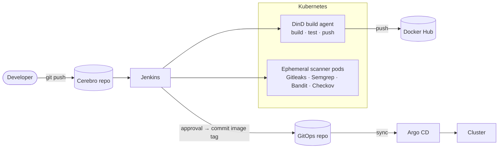

# Cerebro

**A DevSecOps delivery pipeline for a Django web application: containerised builds, security scanning on ephemeral Kubernetes agents, and GitOps deployment through Argo CD.**


The application is a Django + PostgreSQL discussion platform where every message is screened by Google's Perspective API before it's saved. The pipeline around it builds, tests and scans each release, publishes a versioned image, and deploys by committing the new tag to a GitOps repository that Argo CD reconciles into the cluster.

## Architecture



| Stage | What it does |
|-------|--------------|
| Build | Builds `joellots/cerebro:<VERSION>` and starts the app + PostgreSQL with Docker Compose |
| Unit tests | 29 pytest tests with coverage, run inside the container against the live database |
| Gitleaks | Secret detection |
| Semgrep · Bandit | Multi-language and Python-specific SAST |
| Checkov | Misconfiguration scan of Terraform, Kubernetes manifests and the Dockerfile |
| Push | Publishes the versioned image to Docker Hub |
| Deploy | Manual approval, then commits the new image tag to the GitOps repo for Argo CD to roll out |

## Design decisions

- **Disposable scanner pods.** Each scan runs in its own pod from the tool's upstream image, created for the stage and destroyed after. No tooling on the controller, no version conflicts, no idle capacity.
- **Docker-in-Docker instead of socket mounting.** Builds use a sidecar `dind` daemon scoped to the agent pod, so a job never gets root on the node.
- **Jenkins never touches the cluster.** It can only push to the GitOps repo; Argo CD owns the cluster. Every deploy is a reviewable commit, and rollback is `git revert`.
- **Least privilege throughout.** Credentials are injected at runtime from the Jenkins store, and the application container runs as an unprivileged user.

## Quick start

Requires Docker with Compose on Linux.

```bash
git clone https://github.com/Joellots/_Cerebro.git && cd _Cerebro
export DB_USER=cerebro DB_PASSWORD=change-me DB_HOST=localhost REGISTRY=joellots/cerebro VERSION=dev

docker compose -f docker-compose-db.yaml up -d
docker compose -f docker-compose-app.yaml up -d --build   # → http://localhost:8000
```

To reproduce the full pipeline (Terraform host, Jenkins, Argo CD), see **[docs/SETUP.md](docs/SETUP.md)**.

## Roadmap

- Make security scans blocking on high-severity findings (currently advisory)
- Run the four scanners in parallel
- Add image scanning (Trivy) and SBOM generation (Syft)
- Add DAST with OWASP ZAP against the stack started in the Build stage
- Move remaining configuration secrets into environment variables

---

**Joel Chidike Okore** · MSc Security and Network Engineering, Innopolis University
